# Guardian Angel &mdash; Feature Knowledge Graph (FKG)
*Version: 3.0.0 &bull; Patient Experience Upgrade & Provider Isolation &bull; Scope: Web & Mobile*

---

## 1. Feature Inventory & Role Matrix

This matrix categorizes every platform capability by target role, lifecycle status, primary route, and verified delivery state.

| Feature ID | Feature Name | Target Role | Target Status | Primary Route | Description / Purpose |
| :--- | :--- | :--- | :--- | :--- | :--- |
| **F-01** | Landing & Hero Narrative | Guest / All | **Completed** | `/` &rarr; `/login` | UAE pre-marital screening context, core editorial values, and single clear entry-point (deduplicated CTAs). |
| **F-02** | Quick Risk Estimator | Guest & Patient | **Completed** | `/login#estimator` | 2-minute non-clinical probability estimator for consanguineous marriages; local state preservation. |
| **F-03** | Guest-to-Auth Handoff | Guest &rarr; Patient | **Completed** | `/login` (Modal) | Auto-migrates temporary answers & documents from `localStorage` to authenticated account. |
| **F-04** | Patient Dashboard | Patient | **Completed** | `/dashboard` (Tab 1: Home) | Slimmed, calm copy: 1-line greeting, bold 1-sentence Risk vs Diagnosis banner, 4-step care tracker, 3 condensed summary cards (<= 15 words). |
| **F-05** | AI Couple Assessment | Patient | **Completed** | `/couple-assessment` (Tab 2: Couple Check) | 1-to-many compatibility assessments; *"Help us know more about your potential spouse"* intake; deduplicated CTA buttons; clinical modules hidden for patients. |
| **F-06** | Auto-Escalation to Counselor | Patient | **Completed** | `/couple-assessment` | Auto-detects elevated risks/known traits and highlights calm recommended counselor consultation. |
| **F-07** | Genetic Counselors Booking | Patient | **Completed** | `/counselors` (Tab 4: Counselors) | Directory of 5 UAE counselors; 1-line concise bios; 14-day rolling slots; consent-based encrypted booking option. |
| **F-08** | Ask AI Educational Assistant | Patient | **Completed** | `/ask-ai` (Tab 5: Ask AI) | Dedicated AI guide; persistent 1-line disclaimer (*"Educational guide only — not medical advice."*); model switcher, prompt suggestions, timestamped sources. |
| **F-09** | Privacy & Partner Consent | Patient | **Completed** | `/privacy-profile` (Profile Dropdown) | Granular sharing toggles (combined summary only vs full report), "Who Can See My Data" audit log & 1-tap revocation. |
| **F-10** | Comprehension Feedback | Patient | **Completed** | `/dashboard` &rarr; `/api/patient/comprehension` | 1-tap feedback ("Did this make sense?"), persisted to DB to compute impact metrics. |
| **F-11** | Real Names & Simplified Profile | Patient | **Completed** | `/privacy-profile` (Profile Dropdown) | Real user names everywhere (Reddit pseudonyms removed); simple fields: Name, Age/DOB, Email/Phone, Marital Status, Preferred Language (EN/AR). |
| **F-12** | Interactive 3-Gen Pedigree | Provider | **Provider Only** | `/pedigree` | Full SVG tree builder, consanguinity lines, tier filters, node dossier, JSON/GCS exports. Hidden from Patient view. |
| **F-13** | Clinical Risk Workbench | Provider | **Provider Only** | `/risk-analysis` | V-Genomics 4.2, Sanger sequencing protocol, Punnett squares, proband locus indices. Hidden from Patient view. |
| **F-14** | Crypto / ZK Vault Tools | Provider | **Provider Only** | `/privacy-security` | SHA-256 tokens, PBKDF2 seed derivation, hardware passkeys. Patient automatically redirected to `/privacy-profile`. |
| **F-15** | Dual-Lens Persona Switcher | Provider / Admin | **Provider/Admin Only** | Navbar | Switch between Patient View and Clinical Provider View; hidden for regular patients. |
| **F-16** | Genomic Literacy Guide | Patient | **Completed** | `/genomic-literacy` (Tab 3: Genomic Literacy) | 4 foundational educational guides and 6 collapsible accordion cards for UAE conditions (Thalassemia, CF, SMA, Sickle Cell, G6PD, PKU) with "Clear Next Steps". |
| **F-17** | Dual Demo Auth & Multi-Tab Isolation | All Roles | **Completed** | `/login` & `useAuthStore` | Quick demo buttons for Patient (`patient@guardianangel.ae` / `Patient123!`) & Provider (`provider@guardianangel.ae` / `Provider123!`); sessionStorage + `X-Session-User-Id` header for tab isolation. |
| **F-18** | Consent-Based Encrypted Bookings | Patient & Provider | **Completed** | `/counselors`, `/couple-assessment`, `/dashboard` | Patient chooses whether to share identity. When disabled, generates SHA-256 ref (`REF-XXXXXX`); counselors view encrypted profile while patient sees confirmed booking badge. |

---

## 2. Navigation & Entry-Point Graph (Clean Role Split)

```
[User Arrives: / or /login]
  │
  ├── Top Header (Guest)
  │     ├── Logo & Title ("Guardian Angel")
  │     ├── Clean in-page anchors: Overview, Guidance, Specialists
  │     └── Single Primary Action: "Sign In"
  │
  ├── Hero Section (Deduplicated)
  │     ├── Desktop: Single Primary CTA "Start Quick Assessment" + subtle "Sign In" link
  │     └── Mobile: Single Primary CTA "Start 2-Min Quick Assessment"
  │
  ├── Estimator Section (#estimator)
  │     └── 2-Min non-clinical assessment -> Stores in localStorage -> Prompts Auth
  │
  ├── Quick Demo Logins (/login)
  │     ├── "Demo Patient Login" (Tariq Al-Mansoor / patient@guardianangel.ae)
  │     └── "Demo Provider Login" (Dr. Mariam Al Mansoori / provider@guardianangel.ae)
  │
  └── Post-Auth Navigation (Role Split)
        │
        ├── PATIENT VIEW (role === 'patient')
        │     ├── Desktop Top Navbar (5 Tabs + Profile Dropdown)
        │     │     ├── Brand Logo ("Guardian Angel")
        │     │     ├── Tab 1: Home (/dashboard)
        │     │     ├── Tab 2: Couple Check (/couple-assessment)
        │     │     ├── Tab 3: Genomic Literacy (/genomic-literacy)
        │     │     ├── Tab 4: Counselors (/counselors)
        │     │     ├── Tab 5: Ask AI (/ask-ai)
        │     │     ├── Language Toggle (EN / AR)
        │     │     └── Profile Dropdown (Real Name: "Tariq Al-Mansoor" -> /privacy-profile)
        │     │
        │     └── Mobile: 5-Tab Bottom Navigation Bar
        │           ├── Tab 1: Home (Heart)
        │           ├── Tab 2: Couples (Users)
        │           ├── Tab 3: Learn (BookOpen)
        │           ├── Tab 4: Counselors (Stethoscope)
        │           └── Tab 5: Ask AI (Sparkles)
        │
        └── PROVIDER VIEW (role === 'provider')
              ├── Clinical Top Bar (Dual-Lens Switcher, Sudo Mode, Clinical Search)
              └── Desktop Sidebar / Mobile Clinical Drawer:
                    ├── Pedigree Builder (/pedigree)
                    ├── Risk Workbench (/risk-analysis)
                    ├── AI Couple Assessment (Full Clinical Suite: Concordance Matrix, PGT-M Simulator, F-Calc, Biomarkers)
                    └── Clinical Anonymizer / Vault (/privacy-security)
```

---

## 3. Full-Stack Dependency Graph (Feature &rarr; UI &rarr; API &rarr; DB)

```mermaid
graph TD
    subgraph UI ["Frontend (Next.js 16 App Router)"]
        Landing["Landing & Hero (Header, HeroSection)"]
        Estimator["Quick Estimator (Desktop/MobileLoginView)"]
        AuthModal["Auth Modal & Demo Buttons (SocialAuthButtons, useAuthFlow)"]
        HomeView["Tab 1: Home (PatientDashboard - Slimmed Copy)"]
        CoupleView["Tab 2: Couple Check (couple-assessment/page - AI Couple Assessment)"]
        LiteracyView["Tab 3: Genomic Literacy (genomic-literacy/page - Accordions)"]
        CounselorView["Tab 4: Counselors (counselors/page - Encrypted Booking)"]
        AskAiView["Tab 5: Ask AI (ask-ai/page - Educational Assistant)"]
        PrivacyView["Privacy & Profile (privacy-profile/page)"]
        ProviderNav["Provider View (PedigreeCanvas, RiskAnalysis, Clinical Tools)"]
    end

    subgraph API ["Backend REST API (Flask - 100% Parity)"]
        AuthAPI["/api/register, /api/login, /api/me (X-Session-User-Id support)"]
        DashAPI["GET /api/patient/dashboard-state"]
        QA_API["POST /api/patient/quick-assessment/persist"]
        CoupleAPI["GET/POST/DELETE /api/couple-assessments"]
        ApptAPI["GET/POST /api/appointments, /cancel (share_personal_details support)"]
        DocsAPI["GET/POST/DELETE /api/documents"]
        ConsentAPI["GET/POST /api/patient/consent, /revoke"]
        ComprehensionAPI["POST /api/patient/comprehension"]
        ImpactAPI["GET /api/patient/impact-metrics"]
        ConditionsAPI["GET /api/patient/conditions"]
        ProvidersAPI["GET /api/patient/providers"]
        AiChatAPI["POST /api/chat"]
        PedigreeAPI["/api/families, /api/pedigree/*"]
    end

    subgraph DB ["Database Schema (SQLite)"]
        T_Users["users (Seeded Patient & Provider demo accounts)"]
        T_Profiles["patient_profiles & provider profiles"]
        T_QA["quick_assessments"]
        T_Couples["couple_assessments"]
        T_Docs["documents"]
        T_Appts["counselor_appointments (Added: share_personal_details, encrypted_patient_ref)"]
        T_Conditions["genetic_conditions (6 seeded UAE conditions)"]
        T_Providers["counselor_providers (5 seeded UAE counselors)"]
        T_Consent["consent_permissions (Granular partner & counselor sharing)"]
        T_Comprehension["comprehension_feedback (1-tap patient comprehension log)"]
        T_Families["families, pedigree_nodes (Provider clinical models)"]
    end

    Landing --> Estimator
    Estimator --> AuthModal
    AuthModal --> AuthAPI
    AuthAPI --> T_Users
    AuthAPI --> T_Profiles
    AuthAPI --> T_QA
    
    HomeView --> DashAPI
    HomeView --> ComprehensionAPI
    HomeView --> ApptAPI
    ComprehensionAPI --> T_Comprehension

    CoupleView --> CoupleAPI
    CoupleView --> ApptAPI
    CoupleAPI --> T_Couples
    CoupleAPI --> T_Docs

    LiteracyView --> ConditionsAPI
    ConditionsAPI --> T_Conditions

    CounselorView --> ProvidersAPI
    CounselorView --> ApptAPI
    ApptAPI --> T_Appts
    ProvidersAPI --> T_Providers

    AskAiView --> AiChatAPI

    PrivacyView --> ConsentAPI
    ConsentAPI --> T_Consent

    ProviderNav --> PedigreeAPI
    PedigreeAPI --> T_Families
```



---

## 4. User Flow State Machine

```
[State 0: Guest Visitor]
   │
   ├── Take Quick Assessment (Client state stored in localStorage)
   │     │
   │     └── [State 1: Assessment Completed (Guest)]
   │           │
   │           └── Click "Save Assessment in Clinical Vault"
   │                 │
   │                 ▼
   │           [State 2: Auth Modal (Register / Login / Quick Demo)]
   │                 │
   │                 ├── Option A: 1-Tap "Demo Patient Login"
   │                 ├── Option B: 1-Tap "Demo Provider Login"
   │                 └── Option C: Submit Custom Credentials
   │                       │
   │                       ├── Server persists QA payload + documents
   │                       └── Auto-builds Patient Profile (has_quick_assessment=1)
   │                             │
   │                             ▼
   ├── Direct Signup (No QA) ─────────────────────────┐
   │     │                                            │
   │     └── Auto-builds Profile (has_qa=0)            │
   │                                                  │
   ▼                                                  ▼
[State 3: Authenticated Patient Dashboard (Tab 1: Home)]
   │
   ├── View Slimmed Status Card (<15 words) + Bold Risk vs Diagnosis Banner
   ├── Track 4-Step Care Journey (Quick Check -> Booked -> Lab -> Specialist)
   ├── 1-Tap Comprehension Feedback ("Did this make sense?") -> Persists to DB
   ├── Upcoming Appointment Card (Encrypted Ref status / Cancel)
   │
   ├── Tab 2: Couple Check (/couple-assessment) ───────────────┐
   │     ├── View / Switch Saved Matches (One-to-Many)        │
   │     ├── Intake Modal: "Help us know more about spouse"   │
   │     ├── Single "+ New Couple Check" & single Book CTA    │
   │     └── Clinical modules hidden for Patients             │
   │                                                           │
   ├── Tab 3: Genomic Literacy (/genomic-literacy) ───────────┤
   │     ├── 4 Plain-Language Educational Guides              │
   │     └── 6 Accordion Cards for UAE Conditions             │
   │           └── Tap to expand "Clear Next Steps"           │
   │                                                           │
   ├── Tab 4: Counselors (/counselors) ────────────────────────┤
   │     ├── Browse 5 Seeded UAE Counselors (1-line bios)     │
   │     ├── Select Session Type: Self or Couple Check        │
   │     ├── Consent Choice: Share Name & Contact? (Yes / No) │
   │     │     ├── Yes: Real name shared with counselor       │
   │     │     └── No: Generates SHA-256 ref (REF-XXXXXX)     │
   │     └── Confirm Booking -> Added to Dashboard Appts      │
   │                                                           │
   ├── Tab 5: Ask AI (/ask-ai) ────────────────────────────────┤
   │     ├── Persistent Disclaimer: "Educational guide only"  │
   │     ├── Model Selector & Pre-filled Question Chips       │
   │     └── Calm, plain-language genetic guidance            │
   │                                                           │
   └── Header Profile Dropdown (/privacy-profile) ────────────┘
         ├── Real Name displayed (Tariq Al-Mansoor)
         ├── Granular Partner Sharing Toggle (Combined only vs Full)
         ├── Counselor Document Access Toggle
         ├── "Who Can See My Data" Audit Log + 1-Tap Revocation
         └── Simple Profile Details (Name, Age, Email/Phone, Lang)
```

---

## 5. Summary of Completed Enhancements

- **Phase 0 & Graph Sync:** Created and maintained persistent `docs/FEATURE_KNOWLEDGE_GRAPH.md` tracking all 18 features, navigation routes, APIs, and schemas.
- **Phase 1 (Landing Page & Global UX Fix):**
  - Deduplicated Header and Hero CTAs (single primary hero CTA).
  - Normalized vertical spacing across Desktop (1440px) and Mobile (390px).
  - Centered modals on desktop with click-to-dismiss backdrops; bottom-sheet friendly on mobile.
- **Phase 2 (Patient View Cleanup & Role Isolation):**
  - Crypto artifacts (raw tokens, ZK seed backups, hardware keys, Reddit pseudonyms) removed from Patient View.
  - Complex clinical tools (Pedigree Builder, Clinical Risk Workbench, Sanger/Punnett charts, Variant Concordance Matrix, PGT-M Simulator, F-CALC) isolated strictly in Provider View (`role === 'provider'`).
  - Real names used throughout Patient View (e.g. Tariq Al-Mansoor).
- **Phase 3 (5-Tab Responsive Shell & Challenge-Aligned Features):**
  - **Tab 1: Home (`/dashboard`):** 1-line greeting, bold 1-sentence Risk vs Diagnosis banner, 4-step Care Tracker, 3 bottom summary cards with 1-line headline + <=15 words description.
  - **Tab 2: Couple Check (`/couple-assessment`):** Renamed to "AI Couple Assessment", deduplicated buttons, 1-to-many match profiles, and auto-escalation to accredited counseling.
  - **Tab 3: Genomic Literacy (`/genomic-literacy`):** Dedicated route with 4 foundational guides and 6 collapsible accordion cards for UAE conditions with category filter and "Clear Next Steps" reveal.
  - **Tab 4: Counselors (`/counselors`):** 5 seeded UAE counselors with 1-line bios, 14-day rolling slots, and consent-based encrypted booking.
  - **Tab 5: Ask AI (`/ask-ai`):** Dedicated AI assistant with persistent medical disclaimer (*"Educational guide only — not medical advice."*), common question chips, and reassuring plain-language explanations.
- **Phase 4 (Encrypted Bookings & Multi-Tab Isolation):**
  - Database schema extended with `share_personal_details` (INTEGER DEFAULT 1) and `encrypted_patient_ref` (TEXT) in `appointments`.
  - When patient opts out of sharing personal details, a SHA-256 reference (e.g. `REF-8F3A2C`) is generated. The counselor sees `[Confidential - Encrypted Booking]`, while the patient sees their normal confirmed booking with an encrypted badge.
  - Seeded demo credentials for immediate testing:
    - **Patient:** `patient@guardianangel.ae` / `Patient123!` (`Tariq Al-Mansoor`)
    - **Provider:** `provider@guardianangel.ae` / `Provider123!` (`Dr. Mariam Al Mansoori`)
  - Multi-tab session isolation via `sessionStorage` in `useAuthStore.ts` and `X-Session-User-Id` request header + Flask `@app.before_request`, allowing Patient in Tab 1 and Provider in Tab 2 to run simultaneously without session collisions.
- **Phase 5 (Full Verification):**
  - TypeScript compilation: **0 errors**.
  - Next.js production build: **100% successful** (all 14 routes generated cleanly).
  - Python test suites: **All test suites passing with 100% pass rate**.
  - Root and `backend/` mirroring: **100% byte-for-byte parity confirmed across core files**.
