# Guardian Angel &mdash; Feature Knowledge Graph (FKG)
*Version: 2.0.0 &bull; Final Verified Architecture & Dependency Map &bull; Scope: Web & Mobile*

---

## 1. Feature Inventory & Role Matrix

This matrix categorizes every platform capability by target role, lifecycle status, primary route, and verified delivery state.

| Feature ID | Feature Name | Target Role | Target Status | Primary Route | Description / Purpose |
| :--- | :--- | :--- | :--- | :--- | :--- |
| **F-01** | Landing & Hero Narrative | Guest / All | **Completed** | `/` &rarr; `/login` | UAE pre-marital screening context, core editorial values, and single clear entry-point (deduplicated CTAs). |
| **F-02** | Quick Risk Estimator | Guest & Patient | **Completed** | `/login#estimator` | 2-minute non-clinical probability estimator for consanguineous marriages; local state preservation. |
| **F-03** | Guest-to-Auth Handoff | Guest &rarr; Patient | **Completed** | `/login` (Modal) | Auto-migrates temporary answers & documents from `localStorage` to authenticated account. |
| **F-04** | Patient Dashboard | Patient | **Completed** | `/dashboard` (Tab 1: Home) | Plain-language health status, Risk vs Diagnosis banner, 4-step care tracker, comprehension check. |
| **F-05** | Multiple Couple Check | Patient | **Completed** | `/couple-assessment` (Tab 2: Couple) | 1-to-many compatibility assessments; *"Help us know more about your potential spouse"* guided intake. |
| **F-06** | Auto-Escalation to Counselor | Patient | **Completed** | `/couple-assessment` | Auto-detects elevated risks/known traits and highlights calm recommended counselor consultation. |
| **F-07** | Genetic Counselors Booking | Patient | **Completed** | `/counselors` (Tab 3: Counselors) | Directory of 5 UAE counselors; 14-day rolling slots; Self vs Couple session binding. |
| **F-08** | Guardian AI Educational Chat | Patient | **Completed** | `/dashboard`, `/counselors` | Safe educational Q&A; persistent medical disclaimer banner; strictly non-diagnostic. |
| **F-09** | Privacy & Partner Consent | Patient | **Completed** | `/privacy-profile` (Tab 4: Privacy) | Granular sharing toggles (combined summary only vs full report), "Who Can See My Data" audit log & 1-tap revocation. |
| **F-10** | Comprehension Feedback | Patient | **Completed** | `/dashboard` &rarr; `/api/patient/comprehension` | 1-tap feedback ("Did this make sense?"), persisted to DB to compute impact metrics. |
| **F-11** | Simplified Patient Profile | Patient | **Completed** | `/privacy-profile` | Simple fields only: Name, Age/DOB, Email/Phone, Marital Status, Preferred Language (EN/AR). |
| **F-12** | Interactive 3-Gen Pedigree | Provider | **Provider Only** | `/pedigree` | Full SVG tree builder, consanguinity lines, tier filters, node dossier, JSON/GCS exports. Hidden from Patient view. |
| **F-13** | Clinical Risk Workbench | Provider | **Provider Only** | `/risk-analysis` | V-Genomics 4.2, Sanger sequencing protocol, Punnett squares, proband locus indices. Hidden from Patient view. |
| **F-14** | Crypto / ZK Vault Tools | Provider | **Provider Only** | `/privacy-security` | SHA-256 tokens, PBKDF2 seed derivation, hardware passkeys, Reddit pseudonyms. Patient automatically redirected to `/privacy-profile`. |
| **F-15** | Dual-Lens Persona Switcher | Provider / Admin | **Provider/Admin Only** | Navbar | Switch between Patient View and Clinical Provider View; hidden for regular patients. |

---

## 2. Navigation & Entry-Point Graph (Clean Role Split)

```
[User Arrives: / or /login]
  │
  ├── Top Header (Guest)
  │     ├── Logo & Title ("Guardian Angel")
  │     ├── Clean in-page anchors: Overview, Guidance, Specialists
  │     └── Single Primary Action: "Sign In"
  │
  ├── Hero Section (Deduplicated)
  │     ├── Desktop: Single Primary CTA "Start Quick Assessment" + subtle "Sign In" link
  │     └── Mobile: Single Primary CTA "Start 2-Min Quick Assessment"
  │
  ├── Estimator Section (#estimator)
  │     └── 2-Min non-clinical assessment -> Stores in localStorage -> Prompts Auth
  │
  └── Post-Auth Navigation (Role Split)
        │
        ├── PATIENT VIEW (role === 'patient')
        │     ├── Desktop: Calm Top Navbar
        │     │     ├── Brand Logo ("Guardian Angel")
        │     │     ├── Tab 1: Home (/dashboard)
        │     │     ├── Tab 2: Couple Check (/couple-assessment)
        │     │     ├── Tab 3: Counselors (/counselors)
        │     │     ├── Tab 4: Privacy & Profile (/privacy-profile)
        │     │     ├── Language Toggle (EN / AR)
        │     │     └── Patient User Dropdown (No crypto tokens or pseudonyms)
        │     │
        │     └── Mobile: 4-Tab Bottom Navigation Bar
        │           ├── Tab 1: Home (Heart)
        │           ├── Tab 2: Couple Check (Users)
        │           ├── Tab 3: Counselors (Stethoscope)
        │           └── Tab 4: Privacy & Profile (ShieldCheck)
        │
        └── PROVIDER VIEW (role === 'provider')
              ├── Clinical Top Bar (Dual-Lens Switcher, Sudo Mode, Clinical Search)
              └── Desktop Sidebar / Mobile Clinical Drawer (Pedigree, Risk Workbench, Clinical Anonymizer)
```

---

## 3. Full-Stack Dependency Graph (Feature &rarr; UI &rarr; API &rarr; DB)

```mermaid
graph TD
    subgraph UI ["Frontend (Next.js 16 App Router)"]
        Landing["Landing & Hero (Header, HeroSection)"]
        Estimator["Quick Estimator (Desktop/MobileLoginView)"]
        AuthModal["Auth Modal (useAuthFlow)"]
        HomeView["Tab 1: Home (PatientDashboard)"]
        CoupleView["Tab 2: Couple Check (couple-assessment/page)"]
        CounselorView["Tab 3: Counselors (counselors/page)"]
        PrivacyView["Tab 4: Privacy & Profile (privacy-profile/page)"]
        ProviderNav["Provider View (PedigreeCanvas, RiskAnalysis)"]
    end

    subgraph API ["Backend REST API (Flask - 100% Parity)"]
        AuthAPI["/api/register, /api/login, /api/me"]
        DashAPI["GET /api/patient/dashboard-state"]
        QA_API["POST /api/patient/quick-assessment/persist"]
        CoupleAPI["GET/POST/DELETE /api/couple-assessments"]
        ApptAPI["GET/POST /api/appointments, /cancel"]
        DocsAPI["GET/POST/DELETE /api/documents"]
        ConsentAPI["GET/POST /api/patient/consent, /revoke"]
        ComprehensionAPI["POST /api/patient/comprehension"]
        ImpactAPI["GET /api/patient/impact-metrics"]
        ConditionsAPI["GET /api/patient/conditions"]
        ProvidersAPI["GET /api/patient/providers"]
        PedigreeAPI["/api/families, /api/pedigree/*"]
    end

    subgraph DB ["Database Schema (SQLite)"]
        T_Users["users"]
        T_Profiles["patient_profiles"]
        T_QA["quick_assessments"]
        T_Couples["couple_assessments"]
        T_Docs["documents"]
        T_Appts["counselor_appointments"]
        T_Conditions["genetic_conditions (6 seeded UAE conditions)"]
        T_Providers["counselor_providers (5 seeded UAE counselors)"]
        T_Consent["consent_permissions (Granular partner & counselor sharing)"]
        T_Comprehension["comprehension_feedback (1-tap patient comprehension log)"]
        T_Families["families, pedigree_nodes (Provider clinical models)"]
    end

    Landing --> Estimator
    Estimator --> AuthModal
    AuthModal --> AuthAPI
    AuthAPI --> T_Users
    AuthAPI --> T_Profiles
    AuthAPI --> T_QA
    
    HomeView --> DashAPI
    HomeView --> ComprehensionAPI
    HomeView --> ApptAPI
    ComprehensionAPI --> T_Comprehension

    CoupleView --> CoupleAPI
    CoupleView --> ApptAPI
    CoupleAPI --> T_Couples
    CoupleAPI --> T_Docs

    CounselorView --> ProvidersAPI
    CounselorView --> ApptAPI
    ApptAPI --> T_Appts
    ProvidersAPI --> T_Providers

    PrivacyView --> ConsentAPI
    ConsentAPI --> T_Consent

    ProviderNav --> PedigreeAPI
    PedigreeAPI --> T_Families
```



---

## 4. User Flow State Machine

```
[State 0: Guest Visitor]
   │
   ├── Take Quick Assessment (Client state stored in localStorage)
   │     │
   │     └── [State 1: Assessment Completed (Guest)]
   │           │
   │           └── Click "Save Assessment in Clinical Vault"
   │                 │
   │                 ▼
   │           [State 2: Auth Modal (Register / Login)]
   │                 │
   │                 ├── Submit Credentials
   │                 ├── Server persists QA payload + documents
   │                 └── Auto-builds Patient Profile (has_quick_assessment=1)
   │                       │
   │                       ▼
   ├── Direct Signup (No QA) ─────────────────────────┐
   │     │                                            │
   │     └── Auto-builds Profile (has_qa=0)            │
   │                                                  │
   ▼                                                  ▼
[State 3: Authenticated Patient Dashboard (Tab 1: Home)]
   │
   ├── View Plain Status Card + Risk vs Diagnosis Banner
   ├── Track 4-Step Care Journey (Quick Check -> Booked -> Lab -> Specialist)
   ├── 1-Tap Comprehension Feedback ("Did this make sense?") -> Persists to DB
   ├── Upcoming Appointment Card (Cancel / View details)
   │
   ├── Option A: Start Couple Check ──────────────────┐
   │                                                  ▼
   │                             [State 4: Tab 2 - Couple Check]
   │                                ├── View / Switch Saved Potential Matches (One-to-Many)
   │                                ├── Modal: "Help us know more about potential spouse"
   │                                ├── Partner Document Upload
   │                                └── High Risk Detected -> Auto-Escalate to Counseling CTA
   │                                                               │
   │                                                               ▼
   ├── Option B: Book Genetic Counselor ───────────────────────────┤
   │                                                               ▼
   │                             [State 5: Tab 3 - Counselors]
   │                                ├── Browse 5 Seeded UAE Counselors (Specialty, Bio, Slots)
   │                                ├── Select Session Type: Self Analysis or Couple Check
   │                                ├── Select Date/Time Slot across 14-day rolling window
   │                                ├── Guardian AI Educational Assistant with Medical Disclaimer
   │                                └── Confirm Booking -> Added to Upcoming Appointments
   │
   └── Option C: Manage Privacy & Profile ────────────┐
                                                      ▼
                                 [State 6: Tab 4 - Privacy & Profile]
                                    ├── Granular Partner Sharing Toggle (Combined only vs Full)
                                    ├── Counselor Document Access Toggle
                                    ├── "Who Can See My Data" Audit Log + 1-Tap Revocation
                                    ├── Simple Profile Details (Name, Age, Email/Phone, Lang)
                                    └── Language Switcher (EN / AR)
```

---

## 5. Summary of Completed Enhancements

- **Phase 0 & Graph Sync:** Created and maintained persistent `docs/FEATURE_KNOWLEDGE_GRAPH.md` tracking all 15 features, duplicates, APIs, and schemas.
- **Phase 1 (Landing Page & Global UX Fix):**
  - Deduplicated Header and Hero CTAs (single primary hero CTA).
  - Normalized vertical spacing across Desktop (1440px) and Mobile (390px).
  - Centered modals on desktop with click-to-dismiss backdrops; bottom-sheet friendly on mobile.
- **Phase 2 (Patient View Cleanup & Role Isolation):**
  - Crypto artifacts (SHA-256 tokens, ZK seed backups, hardware keys, Reddit pseudonyms) removed from Patient View.
  - Complex clinical tools (Pedigree Builder, Clinical Risk Workbench, Sanger/Punnett charts) isolated strictly in Provider View (`role === 'provider'`).
  - `/profile` and `/privacy-security` automatically redirect regular patients to `/privacy-profile`.
- **Phase 3 (4-Tab Responsive Shell & Challenge-Aligned Features):**
  - Tab 1: `Home` (`PatientDashboard.tsx`) with Risk vs Diagnosis banner, 4-step Care Tracker, 1-tap Comprehension check, and neutral options.
  - Tab 2: `Couple Check` (`couple-assessment/page.tsx`) with 1-to-many profiles and auto-escalation to accredited counseling banner on elevated risk.
  - Tab 3: `Counselors` (`counselors/page.tsx`) with 5 seeded UAE counselors, 14-day rolling slots, and Guardian AI educational chat with persistent medical disclaimer.
  - Tab 4: `Privacy & Profile` (`privacy-profile/page.tsx`) with granular partner/counselor consent toggles, "Who Can See My Data" audit log & 1-tap revocation, simplified profile fields, and EN/AR language toggle.
- **Phase 4 (Full Verification):**
  - TypeScript compilation: **0 errors**.
  - Next.js production build: **100% successful** (all 12 routes generated).
  - Python test suite: **456 core unit tests + 8 dedicated patient journey & experience tests passing (100% pass rate)**.
  - Root and `backend/` mirroring: **100% byte-for-byte parity confirmed**.
